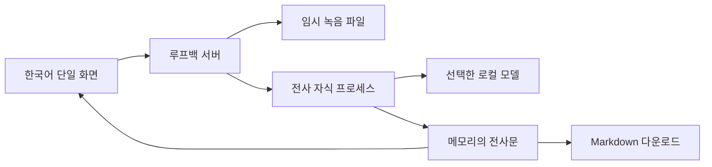
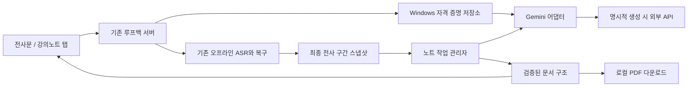

# 데모 아키텍처

> 최신 상태 (2026-11-09): 사용자 후속 요청으로 강의노트 구현이 승인되어 세 종류 생성·키 설정·취소·PDF 기능을 구현했다. 외부 API 실호출과 사용자 무료 프로젝트/노트 품질 검증은 아직 미실행이다. 기존 전사 기능은 유지한다. 아래의 설계만 승인/미구현 표현은 이전 단계 기록이며 현재 상태는 IMPLEMENTATION_STATUS.md의 마지막 항목을 따른다.

외부 API·클라우드·장기 DB·과목 관리·AI 서비스는 없습니다. HTTP는 브라우저와 이 PC의 서버 사이에서만 사용합니다.

상태는 idle → running → completed 또는 failed입니다. 새 입력 선택은 화면 결과를 초기화합니다. 서버는 현재 작업 하나만 소유합니다. 새로고침·앱 종료 후 이어서 처리는 지원하지 않습니다. 오래된 응답은 job_id가 현재 작업과 다르면 화면에 반영하지 않습니다.

src의 보안·실행 잠금·파일 검사를 재사용했습니다. app → Jobs → probe/worker 자식 프로세스 구조이며 보관함 DB는 데모 경로에서 사용하지 않습니다. 기존 데이터는 유지합니다.

## 강의노트 추가 구조 (미구현)

노트 장애와 키 미설정은 ASR 사용을 막지 않는다. 취소/시간 초과 뒤 늦은 완료는 generation·snapshot 검사로 폐기한다. 자세한 경계는 [기술 설계](STUDY_NOTES_TECHNICAL.md)를 따른다.
